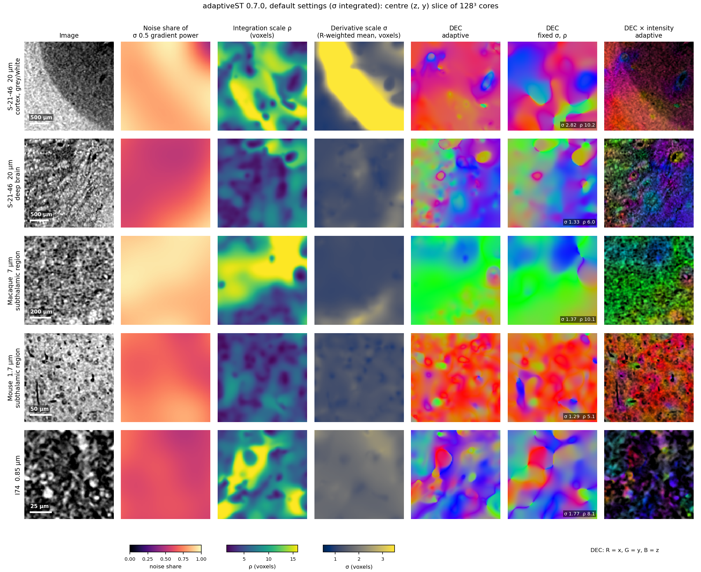
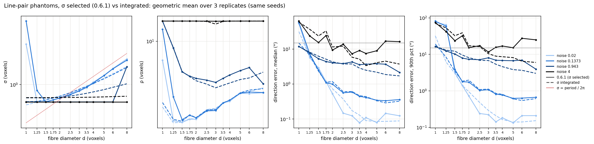
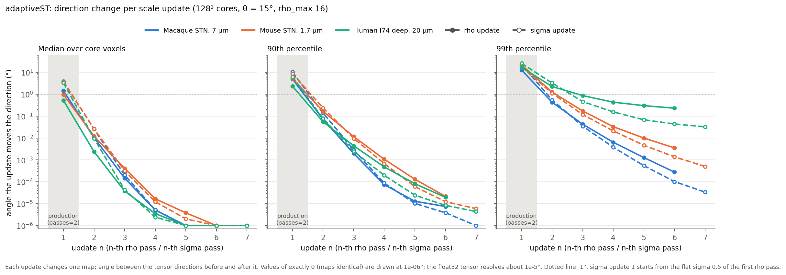

# adaptiveST

3D structure tensors for volumetric images, at fixed scales or with **each voxel's
own derivative scale σ and integration scale ρ, chosen from the image itself**.
CuPy on a CUDA GPU by default; NumPy/SciPy on the CPU where there is none.

```bash
pip install adaptiveST          # CPU
pip install "adaptiveST[gpu]"   # + CuPy (CUDA 12)
```

From a clone: `pip install -e .` (or `-e ".[gpu]"`). The main branch is 0.7.0 (unreleased), which
integrates the derivative scale by default; 0.6.1 on PyPI selects it (`sigma_rule="select"` here).

## Quick start

```python
import numpy as np
import adaptivest as ast

volume = np.load("volume.npy")                     # (Z, Y, X); zarr / memmap arrays work too

# Fixed scales: one sigma and one rho for every voxel
S = ast.structure_tensor(volume, sigma=1.0, rho=3.0)
e = ast.eigen(S)               # e["direction"] (3, Z, Y, X), e["fa"], e["linearity"], e["planarity"]

# Adaptive scales: a sigma and rho per voxel, the noise measured in each voxel's own window
S, maps = ast.adaptive_structure_tensor(volume, return_maps=True)   # mask=... isolates a structure
e = ast.eigen(S)
maps["sigma"], maps["rho"]                          # each voxel's (mean) derivative scale and window, in voxels
maps["noise"]                                       # the noise's share of the gradient power there

rgb = ast.dec(e["direction"][:, 64])                # direction-encoded colour of slice 64
```

Results come back as NumPy arrays; `gpu=False` forces the CPU. Tensor components are
ordered `[zz, yy, xx, zy, zx, yx]` (`ast.COMPONENTS`); the direction is the eigenvector
of the smallest eigenvalue, in (z, y, x) components, with an arbitrary sign.

## Method

| | What it does |
|---|---|
| **σ**, the derivative scale | The image is differentiated with Gaussian derivatives of s.d. σ. It selects the texture whose orientation is measured (the filter responds most to a period of about 2πσ). |
| **ρ**, the integration scale | The gradients' outer products are averaged with a Gaussian of s.d. ρ. Larger ρ averages away more noise and blurs more structure. |

One fixed (σ, ρ) is a compromise wherever noise and contrast vary. Adaptive scales give
each voxel the smallest window that meets a stated precision, and a derivative scale
matched to its local texture:

- **ρ(x): the smallest window that reaches the target precision θ.** For each ρ on the
  grid, the direction's angular variance is predicted as `V = K(x; σ, ρ) · S`, with
  `S = (λ1 + λ3)/(λ1 − λ3)² + (λ2 + λ3)/(λ2 − λ3)²` (first-order perturbation of the
  smallest eigenvector). ρ(x) is where V, smoothed over 2 voxels, first falls to θ²,
  interpolated in log ρ.
- **σ: integrated over every scale, weighted by Lindeberg's response.** For each σ on
  the grid, `R(s)` is `s² |∇L_s|²` averaged over the voxel's window. The tensor is
  `Σ_s s² S(s, ρ) / Σ_s s² tr S(s, ρ)`: each scale's trace-normalised tensor, weighted by
  its share of R. `maps["sigma"]` is the R-weighted geometric mean of s, and sets the
  second ρ. No scale is chosen, so nothing flips: selecting R's first peak (0.6.1,
  `sigma_rule="select"`) drew sharp edges in σ where two textures meet, e.g. a fibre
  bundle seen through a small window.
- **Passes.** ρ at σ = 0.5; σ over that window; ρ again at each voxel's σ. Further
  passes change the directions very little (below).
- **Grids** are log-spaced at ratio √2: ρ from √2 to `rho_max`, σ from 0.5 to
  `rho_max/√2`; the tensor blends between the neighbouring grid ρ in log ρ.

**The local noise and K.** Nothing is calibrated, and nothing is sampled from elsewhere
in the volume. Each voxel's noise spectrum is measured in its own window
(`noise_window`, 128 voxels): per frequency band, the bias-corrected minimum band power
over the window's 4³ sub-windows (Martin's minimum statistics), after dividing each
sub-window by its own noise level above 0.5 cycles/voxel. One draw of Gaussian noise
with that spectrum is added to the image; `K` is the window's sum of squared angles
between the clean and noisy directions over its sum of `S`. `maps["noise"]` is the
noise's share of the gradient power at σ 0.5.

The estimate is the power common to every sub-window. Against LADAF-2021-17's medium
(an independent noise reference) it reads 0.88–0.98 of the true gradient noise in pure
medium, within about 5% above 0.55 cycles/voxel, and 2.6× too high in dense deep grey
matter, where texture fills every sub-window. A regular fibre array is counted as noise
entirely.

### Settings

| Setting | Default | Meaning |
|---|---|---|
| `precision_deg` | 15 | target angular s.d. θ of each direction under the image's noise; smaller gives larger windows |
| `rho_max` | 16 | largest window (voxels); also sets σ's range, the halo and much of the cost |
| `noise_window` | 128 | width (voxels) of the window each voxel's noise and `K` are measured in |
| `mask` / `threshold` | none | the structure to isolate (see Masking) |
| `chunk` | `"auto"` | tile side; `"auto"` takes the largest padded tile that fits free memory |
| `truncate` | 3 | Gaussian kernel radius in s.d. |
| `sigma_rule` | `"integrate"` | `"select"`: 0.6.1's first peak of R and a tensor at that σ; settings saved by 0.6.1 load as `"select"` |

**Choosing θ from a tracker's tolerance.** A tracker that rejects links more than α
apart wrongly rejects a correct link with probability about `exp(−α²/2θ²)`, so
`θ = α / √(2 ln(1/p))`: α = 40° and p = 5% give θ ≈ 16°.

## Example: five native-resolution datasets



*Rows: S-21-46 (human, HiP-CT) at 20 µm, a cortex core across the grey/white boundary and a
deep-brain core; macaque at 7 µm and mouse at 1.7 µm, both in the subthalamic region; I74
(human) at 0.85 µm. Each shows the centre slice of a 128³ core computed with 166 voxels of
real tissue around it. Columns: the image; the noise share; ρ(x); σ(x) (the R-weighted
mean); DEC (R = x, G = y, B = z) with adaptive scales; DEC at fixed scales equal to the
adaptive means; adaptive DEC weighted by intensity. Default settings (adaptiveST 0.7.0).*

| | noise share (5–95%) | ρ median (10–90%) | σ median | at `rho_max` |
|---|---|---|---|---|
| S-21-46 20 µm, cortex | 0.70–0.95 | 10.6 (4.6–15.6) | 2.39 | 4% |
| S-21-46 20 µm, deep brain | 0.52–0.92 | 5.5 (3.0–9.7) | 1.26 | 0% |
| Macaque 7 µm | 0.79–0.96 | 10.3 (4.2–15.9) | 1.21 | 8% |
| Mouse 1.7 µm | 0.60–0.81 | 4.7 (2.8–7.8) | 1.29 | 0% |
| I74 0.85 µm | 0.54–0.72 | 7.4 (3.8–13.6) | 1.74 | 1% |

- **σ and ρ are smooth maps.** ρ follows contrast (4.7 median in the mouse, about 10 in
  the macaque and the human cortex); σ stays near 1.2–1.3, higher at 0.85 µm (1.7).
- **Adaptive directions are more coherent than fixed ones** at the same mean scales:
  compare the two DEC columns.
- **σ rises at sharp tissue interfaces** (the yellow band at the grey/white boundary,
  σ up to 5.7): a step edge has the same R at every scale, so the coarse scales share the
  weight and the tensor there follows the boundary.

### Integrated against selected σ on phantoms



*Parallel cylinders of diameter d (period 2d) in white noise, 12 diameters × 12 noise
levels × 3 replicates (random fibre direction, lattice rotation, phase and noise draw);
the median over each 32³ core, geometric mean over replicates. Run with a pre-release
build that weighted scales over the first-pass window; on the five datasets above its
directions are within 0.2–0.8° (median) of 0.7.0's.*

Over the 432 runs the integrated tensor's median direction error is 1.12× lower
(geometric mean) and lower in 233. Thick fibres gain most, at moderate to high noise:
1.35× lower for d ≥ 3.5, e.g. 16° → 3.7° at d 8 and noise s.d. 4. Thin fibres
(d 1.5–3) lose 1.13×, mostly at high noise (15° → 24° at d 1.5, noise 4), and a few
tenths of a degree at low noise.

## Convergence of the passes



*Measured with 0.6.1 (σ selected). Angle each update moves the directions, over a 128³ core,
for six iterations of the chain `(0.5, ρ₀) → (σ₀, ρ₀) → (σ₀, ρ₁) → (σ₁, ρ₁) → …` (solid: ρ updates; dashed: σ
updates; shaded: what the default computes). Macaque STN at 7 µm, mouse STN at 1.7 µm,
human I74 at 20 µm.*

The first σ and ρ updates move directions by a median 3–4° and 0.5–1.4°; every later
update moves them by under 0.03°, about 50–100 times less per pass. On I74, 0.4% of
voxels keep moving by more than 1° per pass, alternating between two states.

## Cost

- **Halo:** 166 voxels at the defaults (the scale chain's 94 plus the noise window's
  pooling reach, 72); fixed σ 1, ρ 3 needs 12.
- **Memory:** about 100 bytes per voxel of the padded tile; `chunk="auto"` picks 128 on
  a 12 GB GPU (460³ tile, 9.0 GB peak).
- **Speed:** about 95 s per 128³ chunk on an RTX A2000 (12 GB) with 0.6.1; much slower on
  the CPU. About half is `K`, measured at each grid σ the core uses. Integrating σ blends
  the tensor at every grid σ but drops the search, and cost about the same overall (within
  ±20% per dataset). Fused GPU kernels (default) give 1.17x; `stride=2` about 1.4x more.

Lowering `rho_max` or `noise_window` cuts all three.

## Limitations

- **Texture that fills a window is counted as noise** (above), which overstates ρ: by
  about a third in deep grey matter. Odd/even half-reconstructions would give the true
  local noise.
- **Near a volume's faces** the large windows and the noise window see edge replication,
  not tissue, within about the halo. On the GPU, `K` falls towards zero where two faces
  meet. Compute on a larger volume than you need.
- **The noise draw is isotropic within each band**; axis-dependent noise (CT streaks) is
  not reproduced.
- **Chunking changes the result statistically:** each tile draws its own noise.
- **Bright specks and strong edges get small windows,** and bias is not modelled: the
  rule limits noise only. At a sharp tissue interface the integrated σ also leans to the
  coarse scales, so the tensor reads the interface's orientation; mask the structure to
  avoid it.
- **ρ's precision target assumes one σ.** It is met at the mean σ; the integrated tensor,
  which adds coarser and less noisy scales, is usually more precise than that.
- **FA and linearity change meaning with the scales,** which differ from voxel to voxel.

## API

| Function | |
|---|---|
| `structure_tensor(volume, sigma, rho, *, truncate=3, gpu=None)` | fixed-scale tensor, (6, Z, Y, X) |
| `AdaptiveScales(precision_deg=15, truncate=3, rho_max=16, noise_window=128, passes=2, stride=1, sigma_rule="integrate")` | the settings; `passes=1` stops after the first ρ and its σ (about 5x faster, less accurate); `stride=2` or `4` evaluates the larger windows on a lattice and interpolates (about 1.4x faster, maps within 0.01 in log ρ) |
| `adaptive_structure_tensor(volume, scales=None, *, mask=None, threshold=None, chunk="auto", gpu=None, return_maps=False)` | per-voxel-scale tensor |
| `scale_maps(volume, scales=None, *, mask=None, threshold=None, chunk="auto", gpu=None)` | `{"sigma", "rho", "noise"}` maps only |
| `scale_maps_chunk(volume, origin, size, scales=None, *, gpu=None)` | one chunk's maps, read with `scales.halo()` of context |
| `tensor_from_scales(block, sigma, rho, scales, *, gaussian_filter, tensor_dtype, xp=None, margin=0)` | the blend step from stored maps; needs `blend_halo(scales)` (82) of margin |
| `eigen(S)` | `values`, `direction`, `fa`, `linearity`, `planarity` |
| `dec(direction, weight=None)` | direction-encoded colour |
| `AdaptiveScales.as_dict()` / `from_dict()` | save and reuse the settings |

To split the work, compute the maps once (`scale_maps` or `scale_maps_chunk`), store them
(float16 is enough) and build the tensor where it is needed with `tensor_from_scales`.

## Masking

`mask` (nonzero to keep) or `threshold` (keep `volume > threshold`) isolates a structure,
such as white matter. Gradients are those of the normalised convolution
`G*(m·I) / G*(m)`, so the mask's edge is never differentiated; only kept voxels are
averaged (without renormalising, so windows grow near the edge); outside the mask the
tensor is zero and the maps NaN, and empty chunks are skipped. The noise spectrum ignores
the mask; `K` uses the kept voxels. On I74 at 20 µm, more than 40 voxels inside a
white-matter mask nothing changes; within 5 voxels of its edge an unmasked tensor follows
the edge's contrast (direction 6° away, median).

## Tests

```bash
pytest -q             # CPU
pytest -q -m gpu      # CuPy against NumPy
```
