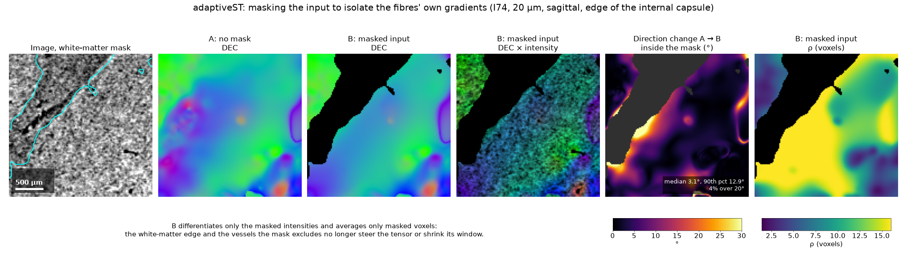
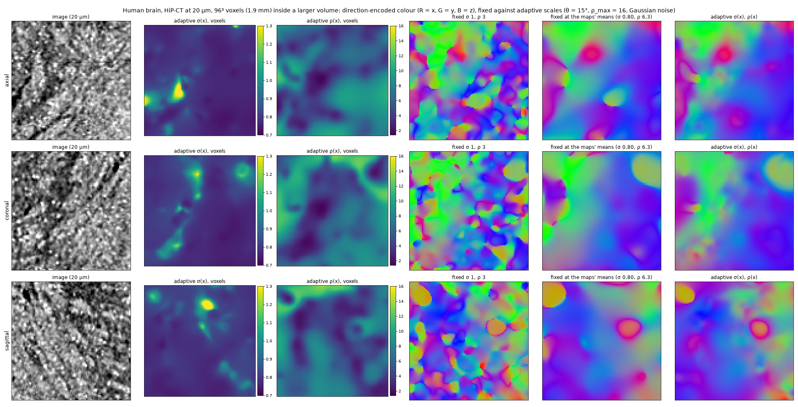

# adaptiveST

3D structure tensors for volumetric images, at fixed scales or with **each voxel's
own derivative scale σ and integration scale ρ, chosen from the image itself**.
CuPy on a CUDA GPU by default; NumPy/SciPy on the CPU where there is none.

```bash
pip install -e .            # CPU
pip install -e ".[gpu]"     # + CuPy (CUDA 12)
```

## Quick start

```python
import numpy as np
import adaptivest as ast

volume = np.load("volume.npy")                     # (Z, Y, X); zarr / memmap arrays work too

# Fixed scales: one sigma and one rho for every voxel
S = ast.structure_tensor(volume, sigma=1.0, rho=3.0)
e = ast.eigen(S)               # e["direction"] (3, Z, Y, X), e["fa"], e["linearity"], e["planarity"]

# Adaptive scales: a sigma and rho per voxel, the noise measured in each voxel's own window
S, maps = ast.adaptive_structure_tensor(volume, return_maps=True)   # mask=... isolates a structure
e = ast.eigen(S)
maps["sigma"], maps["rho"]                          # the scales each voxel used, in voxels
maps["noise"]                                       # the noise's share of the gradient power there

rgb = ast.dec(e["direction"][:, 64])                # direction-encoded colour of slice 64
```

Everything runs on the GPU (CuPy) when there is one, else on the CPU; `gpu=False` forces the CPU.
Results come back as NumPy arrays.
The tensor's components are ordered `[zz, yy, xx, zy, zx, yx]` (`ast.COMPONENTS`); the
direction is the eigenvector of the smallest eigenvalue, in (z, y, x) components, with
an arbitrary sign.

## Fixed against adaptive scales

The structure tensor has two Gaussian scales:

| | What it does |
|---|---|
| **σ**, the derivative scale | The image is differentiated with Gaussian derivatives of s.d. σ. It selects the texture whose orientation is measured (the filter responds most to a period of about 2πσ) and suppresses noise above it. |
| **ρ**, the integration scale | The gradients' outer products are averaged with a Gaussian of s.d. ρ. It sets how many gradients agree on one direction: larger ρ averages away more noise and blurs more structure. |

**Fixed scales** apply one (σ, ρ) to the whole volume. That is a compromise wherever
noise and contrast vary: a window large enough for the noisiest, lowest-contrast tissue
blurs well-resolved structure elsewhere, and a window small enough for that structure
leaves the noisy tissue as speckle.

**Adaptive scales** give each voxel the smallest window that meets a stated precision,
and a derivative scale matched to its local texture.

- **ρ(x): the smallest window that reaches a target angular precision.** For each ρ on
  the grid, the tensor predicts the angular variance of its direction as
  `V = K(x; σ, ρ) · S`, with `S = (λ1 + λ3)/(λ1 − λ3)² + (λ2 + λ3)/(λ2 − λ3)²`. That is
  the first-order perturbation of the smallest eigenvector: large eigenvalue gaps, a
  well-determined direction. `K(x; σ, ρ)` is measured in the voxel's own window: one
  draw of the window's own noise is added to the image, and `K` is the window's mean
  squared angle by which it moves the direction, over its mean `S` (see below). ρ(x) is
  where V (smoothed over 2 voxels) first falls to `precision_deg²`, interpolated in
  log ρ.
- **σ(x): Lindeberg's scale over the voxel's own window.** The first peak over scale
  of the normalised gradient energy `s² |∇L_s|²`, averaged with a Gaussian of width
  ρ(x). For a lattice of fibres the peak sits at the lattice period over 2π; where
  the finest texture is noise, at about 0.7 voxels.
- **Three passes.** ρ at σ = 0.5 (nearly no smoothing, so the first window is not
  skewed by an assumed σ); σ over that window; ρ again at each voxel's σ. Further
  passes changed ρ by under 0.2% (measured on HiP-CT with the earlier, calibrated
  version), so one is used.
- **The tensor** blends trace-normalised tensors at the neighbouring grid (σ, ρ),
  bilinearly in (log σ, log ρ), so both scales vary continuously from voxel to voxel.
- **The grids** are log-spaced at ratio √2, two samples per octave: ρ from √2
  (Lindeberg's smallest integration factor) to `rho_max`, σ from 0.5 to `rho_max/√2`.
- **Nothing is calibrated, and nothing is sampled from elsewhere in the volume.** The
  noise spectrum and `K` come from the 128-voxel window around each voxel (and, through
  the window's averaging, from the windows around it: at most 128 voxels away). See
  below.

### The local noise and K

Each voxel's noise is measured from its own window (`noise_window`, 128 voxels by
default), with no noise model and nothing sampled from elsewhere in the volume.

- **Bands.** The window's spectrum is split into `B/2` frequency bands of equal
  coefficient count, `B = ⌈2π·rho_max⌉` (the block that resolves the largest window's
  frequencies), from the window's spectral resolution to the corner of the cube
  (√3/2 cycles/voxel). Equal counts give every band the same statistical precision.
- **The noise power in a band** is the smallest band power among the 4³ sub-windows
  (32³ voxels each) that tile the window, corrected for the bias of a minimum over
  noisy estimates (the expected minimum of N Gamma variables; Martin's minimum
  statistics). Signal and noise are uncorrelated, so a band never holds less power
  than its noise. Where tissue texture is patchy, the quietest sub-window holds little
  else. The log of the minimum is averaged over the window (a Gaussian, s.d. a sixth
  of it, cut at 3 s.d.), so the maps are smooth, and capped at the window's mean band
  power.
- **The level correction.** Real noise is not equally strong everywhere in a window
  (±20% between sub-windows in LADAF's medium), and a plain minimum then picks a
  quieter spot and reads low. So each sub-window's band power is first divided by its
  own noise level: its power above 0.5 cycles/voxel (beyond the Nyquist frequency of
  every axis), relative to the window's. The minimum is scaled back by the window's
  mean level. This assumes the level varies alike at all frequencies and that the
  image has noise above 0.5 cycles/voxel (an upsampled or low-pass filtered image
  does not).
- **The noise layer** is one draw of Gaussian noise with that spectrum: white noise
  split into the same bands, each band scaled at each voxel to its local noise power.
- **K(x).** The tensor is computed on the image and on the image plus the layer, at
  each grid (σ, ρ). `K` at a voxel is the window's sum of squared angles between the
  two directions over its sum of `S`, over the voxels in the linear range (`K·S` and the
  angle below half a random axis's). Larger windows use tensors on a 2× or 4× lattice.
- **`maps["noise"]`** is the noise's share of the gradient power at σ 0.5: 1 where the
  window is all noise.

**What it gets right and wrong.** On LADAF-2021-17, the medium around the brain gives
an independent noise reference (its spectrum, scaled to each tissue window's
high-frequency plateau). Against it:

- In windows of pure medium, the gradient noise at σ 0.5 comes out 0.88–0.98 of the
  window's own power (0.74–0.85 without the level correction), and 0.99 on synthetic
  stationary noise with the medium's spectrum. Adding synthetic noise of known power
  to any window raises the estimate by 1.00–1.06 of that power.
- Above about 0.55 cycles/voxel, where tissue has no signal left, the local estimate
  agrees with the reference to within about 5%.
- Next to the medium (a window that includes some), the quietest sub-window is the
  medium, and the gradient noise at σ 0.5 comes out 1.45× the reference.
- In dense deep grey matter there is no quiet sub-window at 0.1–0.4 cycles/voxel:
  texture is counted as noise, about 2.6× the reference in gradient noise power at
  σ 0.5. Before the level correction (2.3–2.4× there) ρ came out about a third larger
  and directions shifted by about 6° (median) against using the medium's spectrum.

So the local estimate is the power common to every sub-window of a window. It is the
noise where noise dominates or some sub-window is free of structure, and too large
where texture or a regular fibre array fills the whole window: on synthetic uniform
tubes whose noise is 4% of the gradient power it reads about 9× the true
noise. Without a noise-only region in the scan, or half-reconstructions, a single
window cannot tell uniform texture from noise any better.

**Chunking** changes the result only statistically: each tile measures the window
statistics from its own context, with its own noise draw.

### Settings

| Setting | Default | Meaning |
|---|---|---|
| `precision_deg` | 15 | the target angular s.d. of each direction under the image's noise; smaller gives larger windows |
| `rho_max` | 16 | the largest window (voxels); also sets σ's range, the halo and much of the cost |
| `mask` / `threshold` | none | the structure to isolate (mask nonzero, or `volume > threshold`): gradients and averages use only its voxels; zero tensor and NaN maps elsewhere; chunks with nothing to keep are skipped |
| `chunk` | `"auto"` | tile side (voxels): `"auto"` takes the largest whose padded tile fits the free GPU (or CPU) memory; the result depends on it only statistically |
| `noise_window` | 128 | width (voxels) of the window each voxel's noise and `K` are measured in |
| `truncate` | 3 | Gaussian kernel radius in s.d. |

**Choosing the precision from a tracker's tolerance.** If a tractography step rejects
a link whose direction differs by more than α from a node's direction, noise of s.d. θ
wrongly rejects a correct link with probability about `exp(−α²/2θ²)`. A false-rejection
rate p gives `θ = α / √(2 ln(1/p))`: α = 40° and p = 5% give θ ≈ 16°.

**What is measured, what is chosen.** Measured at every voxel: the noise spectrum,
`K`, S, ρ and σ. Chosen: θ; `rho_max`; `noise_window`; the √2 grid spacing and its
ends (theory: scale-space sampling and Lindeberg's integration factor); 2-voxel
smoothings of V and log ρ; the sub-window (a quarter of the window: the better of 16³
and 32³ on LADAF); the maps' cells (a sixteenth of the window); the lattice steps for
large ρ; the noise draw's seed.

### Masking

`mask` (nonzero to keep) or `threshold` (keep `volume > threshold`) isolates a
structure, such as white matter, so the tensor sees only its own fibres' gradients:

- **The gradients come only from kept intensities.** They are the gradients of the
  normalised convolution `G*(m·I) / G*(m)` (Knutsson & Westin's normalised differential
  convolution), so the step where the mask ends is never differentiated.
- **Only kept voxels are averaged,** in the tensor, the ρ search and the σ search. The
  averages are not renormalised: near the mask's edge fewer voxels vote, the predicted
  variance rises, and the window grows to compensate.
- **Outside the mask** the tensor is zero, `eigen` gives no direction, and the maps are
  NaN. A chunk with nothing to keep is not computed at all.
- **The noise spectrum ignores the mask.** `K` is measured over the kept voxels.



*A sagittal 128³ core of I74 at 20 µm, on the edge of the internal capsule, computed
without a mask (A) and with a white-matter mask (B; intensity smoothed at 3 voxels,
above its Otsu threshold of 159). Far from the mask's edge nothing changes: more than
40 voxels in, ρ is 4.2 in both and the direction moves 0.0° (median; 0.1° at the 90th
percentile). Within 5 voxels of the edge, A's tensor is steered by the edge's own
contrast: a smaller window (ρ 7.8 against 13.1) and a direction 6.0° away (median;
26° at the 90th percentile). The vessels inside the white matter are masked out in
the same way.*

## Example: 20 µm HiP-CT (human brain, deep grey and white matter)

This example was made with the earlier version of the method, which fitted one `K` per
volume from sampled blocks instead of measuring it in each voxel's window.



*A 96³ block (1.9 mm) of human brain at 20 µm, computed inside a larger volume so that
every window sees real tissue. Rows: axial, coronal and sagittal slices. Columns:
the image; the adaptive σ(x) and ρ(x) maps; direction-encoded colour (R = x, G = y,
B = z) at fixed σ 1, ρ 3; at fixed scales equal to the maps' means (σ 0.80, ρ 6.3);
and with adaptive σ(x), ρ(x) (θ = 15°, `rho_max` = 16, Gaussian noise). At ρ 3 the
direction field is mostly noise. The mean window removes it but runs fixed-width
blur through every structure, leaving sharp singular points where it straddles two.
The adaptive field keeps the same large-scale organisation and resolves smaller
domains where the image supports a smaller window.*

On a 384³ crop at 20 µm, with θ = 15° and `rho_max` = 16:

- **σ** stays near 0.75–0.85 voxels almost everywhere: the finest texture is at the
  noise's own scale. It rises to about 1.1–1.25 over coarse, streaky fascicular texture.
- **ρ** ranges from about 3.5 to 9.5 voxels (10th–90th percentile). It is smaller in
  well-oriented fascicles, larger in noisy, low-contrast tissue.
- In a tractography pipeline built on this tensor (BRIDGE, with the graph limits
  calibrated separately for each variant), the adaptive tensor gave:

| | Fixed σ 1, ρ 3 | Fixed σ 1, ρ 8 | Adaptive |
|---|---|---|---|
| tracks ending inside deep white matter, per cm | 0.148 | 0.030 | 0.004 |
| median end-to-end extent (voxels) | 249 | 311 | 326 |
| straightness | 0.846 | 0.898 | 0.899 |

Most of the improvement over σ 1, ρ 3 comes from a larger window at all. Adaptivity
adds a further drop in tracks ending inside white matter and some length, at a much
higher cost. There is no ground truth for fibre directions in this tissue.

## Example: five native-resolution datasets


*Rows: two 20 µm regions of the I74 hemisphere (striatum, white matter), I74 VOIs at
10 µm and 2.2 µm, and LADAF-2021-17 at 23.4 µm. Each shows the sagittal centre slice
of a 128³ core computed inside a larger volume. Columns: the image; the noise's share
of the gradient power at σ 0.5 (128-voxel window); ρ(x); σ(x); DEC with adaptive
scales; DEC at fixed scales equal to the adaptive means; and the adaptive DEC weighted
by image intensity. θ = 15°, `rho_max` = 16, default settings, nothing calibrated.*

| | noise share (5–95%) | ρ median (10–90%) | σ median | at `rho_max` |
|---|---|---|---|---|
| I74 20 µm, striatum | 0.60–0.84 | 3.5 (2.0–6.4) | 0.75 | 0% |
| I74 20 µm, white matter | 0.66–0.94 | 4.8 (2.8–6.4) | 0.73 | 0% |
| I74 10 µm | 0.84–0.95 | 8.4 (5.1–12.5) | 0.99 | 0.5% |
| I74 2.2 µm | 0.85–0.95 | 13.3 (7.2–16) | 1.39 | 22% |
| LADAF 23.4 µm | 0.69–0.87 | 3.8 (2.3–6.5) | 0.77 | 0% |

- **At 20–23 µm, ρ is close to the earlier calibrated version** (3.4, 4.0 and 3.8
  there), with the noise varying smoothly across each core.
- **The fine VOIs get much larger windows** than with the earlier calibrated `K`
  (4.7 and 7.3 there). Most of their gradient power at σ 0.5 is counted as noise
  (90–92%), and at 2.2 µm 22% of the core reaches `rho_max`. These VOIs are all tissue,
  with no noise-only region in any window, so this is where the local estimate is
  most likely to count fine texture as noise (see the limitations).

## Cost

The method computes several tensors per voxel: about 8 window sizes in each ρ pass,
the Lindeberg search and the blend, plus, in the noise window, the band analysis, one
noise draw and the tensors of the image and the noisy image at each grid (σ, ρ) the
voxels use.

- **Halo:** 166 voxels at `rho_max` 16, `truncate` 3 and the default 128-voxel noise
  window: the scale chain's 94 plus the window's pooling reach (72). Fixed σ 1, ρ 3
  needs 12.
- **Memory:** about 100 bytes per voxel of the padded tile. `chunk="auto"` picks 128
  on a 12 GB GPU (a 460³ tile, 9.0 GB peak).
- **Speed:** about 95 s per 128³ chunk on a laptop-class GPU (RTX A2000, 12 GB),
  44 µs per kept voxel; 64³ chunks cost 187 µs per kept voxel. Much more on the CPU.
  About half is the noise factors: `K` is measured at every grid σ that the core's
  σ(x) reaches (six on LADAF, σ 0.5–2.8), about 8 s each.

Lowering `rho_max` or `noise_window` cuts all three.

## Limitations

- **Texture or structure that fills a window is counted as noise.** The local estimate
  is the power common to every sub-window: in deep grey matter, where no sub-window is
  free of texture at 0.1–0.4 cycles/voxel, it overstates the gradient noise at σ 0.5
  by about 2.6× (LADAF-2021-17, against the medium's spectrum), and ρ by about a
  third. A regular fibre array filling the window is counted too. Where a window
  includes something noise-only (medium, a ventricle) it is close. Odd/even
  projection half-reconstructions would give the true local noise.
- **`K` is unreliable near a volume's edges on the GPU.** Where a tile is
  edge-replicated along two axes the padded image has no direction, and those voxels'
  perturbation factors dominate `K`'s ratio of sums: `K` falls towards zero and ρ to
  its minimum within the noise window's reach of an edge where two faces meet. The CPU
  result differs there. Interior voxels are unaffected.
- **The noise layer is isotropic within each band.** Noise that is stronger along one
  axis (CT streaks; on LADAF the medium's noise is 0.5–1.5× the mean along different
  axes) is drawn equally in all directions.
- **Chunking changes the result statistically.** Each tile measures the window
  statistics from its own context and draws its own noise; directions agree to well
  under a degree between chunkings, but not bit for bit.
- **Bright specks and strong edges get small windows.** High contrast predicts a
  precise direction even when that direction is the speck's or the edge's.
- **Bias is not modelled.** The rule limits noise only; a large window in weak texture
  can still average across neighbouring structures.
- **Near a volume's faces the windows see edge replication, not tissue.** Within
  about the halo (166 voxels at the defaults) of the faces, the large windows and the
  noise window average padded values. Compute on a larger volume than you need, or
  lower `rho_max` and `noise_window`.
- **Scalars from the adaptive tensor change meaning with the scales.** FA and
  linearity are computed over windows that differ from voxel to voxel.

## API

| Function | |
|---|---|
| `structure_tensor(volume, sigma, rho, *, truncate=3, gpu=None)` | fixed-scale tensor, (6, Z, Y, X) |
| `AdaptiveScales(precision_deg=15, truncate=3, rho_max=16, noise_window=128)` | the settings |
| `adaptive_structure_tensor(volume, scales=None, *, mask=None, threshold=None, chunk="auto", gpu=None, return_maps=False)` | per-voxel-scale tensor of the structure `mask` (or `volume > threshold`) keeps; the default settings when `scales` is None |
| `scale_maps(volume, scales=None, *, mask=None, threshold=None, chunk="auto", gpu=None)` | `{"sigma", "rho", "noise"}` maps only |
| `scale_maps_chunk(volume, origin, size, scales=None, *, gpu=None)` | the maps of one chunk, read with `scales.halo()` of context: for running chunks as separate tasks |
| `tensor_from_scales(block, sigma, rho, scales, *, gaussian_filter, tensor_dtype, xp=None, margin=0)` | the blend step alone, from maps computed earlier: `block` needs only `blend_halo(scales)` of margin (82 voxels at the defaults, against `halo()` 166), and costs a few fixed-scale tensors |
| `eigen(S)` | `values`, `direction`, `fa`, `linearity`, `planarity` |
| `dec(direction, weight=None)` | direction-encoded colour |
| `AdaptiveScales.as_dict()` / `from_dict()` | save and reuse the settings |

Splitting the work: compute the maps once (`scale_maps`, or `scale_maps_chunk` per
task), store them (float16 is enough), and build the tensor wherever it is needed
with `tensor_from_scales`. The result is the one-shot tensor's up to the stored
precision.

## Tests

```bash
pytest -q             # CPU
pytest -q -m gpu      # CuPy against NumPy
```
